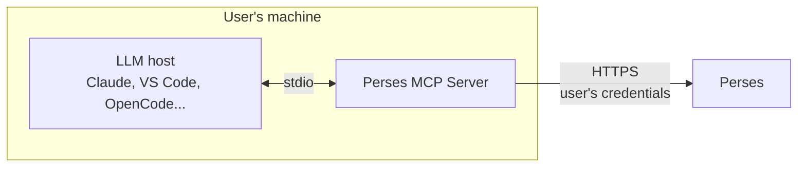
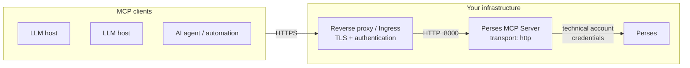

# Deployment

The Perses MCP Server can be deployed in two ways, depending on the [transport](./configuration.md#definition) it uses:

- [Locally, with the stdio transport](#local-deployment-with-stdio): each user runs their own MCP server on their
  machine, started by their LLM host.
- [As a shared service, with the Streamable HTTP transport](#shared-deployment-with-streamable-http): a single MCP server
  runs next to Perses, and several LLM hosts or AI agents connect to it.

|                     | stdio                                     | Streamable HTTP                                       |
|---------------------|-------------------------------------------|-------------------------------------------------------|
| Runs                | On the user's machine, started on demand  | As a long-lived service (container, Kubernetes...)    |
| Identity in Perses  | The user's own account                    | A technical account, shared by all the clients        |
| Network exposure    | None                                      | An HTTP endpoint to protect                           |
| Recommended for     | Individual usage                          | Teams, remote LLM hosts, AI agents and automations    |

When in doubt, start with the stdio transport: it is the simplest and the safest setup.

## Local deployment with stdio

The LLM host starts the MCP server as a sub-process and talks to it through its standard input and output. Nothing is
exposed on the network: only the LLM host can use the MCP server, and the MCP server only talks to Perses.



Each user configures the MCP server with their own credentials, so the LLM gets exactly the permissions of the user in
Perses:

```yaml
perses_server:
  url: "https://perses.example.com"
  native_auth:
    login: "<LOGIN>"
    # Better passed with the environment variable PERMCP_PERSES_SERVER_NATIVE_AUTH_PASSWORD
    password: "<PASSWORD>"
```

See [MCP clients](./clients.md#stdio) to register the MCP server in your LLM host.

> [!NOTE]
> If you log in to Perses with an external identity provider (OIDC, OAuth), you don't have a password to put in the
> configuration. You can use the token returned by `percli whoami --show-token` with the
> [`authorization`](./configuration.md#authorization-config) configuration, but this token expires after the
> `access_token_ttl` configured in Perses (15 minutes by default). You will have to renew it regularly.

## Shared deployment with Streamable HTTP

The MCP server runs as a long-lived service and listens for MCP requests over HTTP. Several LLM hosts, AI agents or
automations can connect to it through its URL, without installing anything.



All the clients share the identity configured in the MCP server. The best fit is a technical account created for the MCP
server, with credentials that don't expire, for example with the
[OAuth 2.0 client credentials flow](./configuration.md#oauth-config) brokered by Perses:

```yaml
transport: http
listen_address: ":8000"
read_only: true

perses_server:
  url: "https://perses.example.com"
  oauth:
    clientID: "perses-mcp"
    # Better passed with the environment variable PERMCP_PERSES_SERVER_OAUTH_CLIENTSECRET
    clientSecret: "<CLIENT_SECRET>"
    # The token endpoint of Perses, for the OIDC provider with the slug_id "keycloak"
    tokenURL: "https://perses.example.com/api/auth/providers/oidc/keycloak/token"
    authStyle: 2
```

See [Choosing an authentication method](./configuration.md#choosing-an-authentication-method) for the other options.

### Security

The MCP server doesn't authenticate the MCP clients: anyone who can reach its HTTP endpoint can use all its tools, with
the permissions of the identity configured in Perses. Before deploying it as a shared service:

- **Never expose the MCP server directly.** Put it behind a reverse proxy, an ingress or an API gateway that
  authenticates the clients, or restrict the network access to the clients you trust. Most of the LLM hosts can send
  custom HTTP headers (see [MCP clients](./clients.md#streamable-http)), for example a token expected by your proxy.
- **Terminate TLS in front of it.** The MCP server only serves plain HTTP.
- **Restrict what the MCP server can do.** Give its technical account the smallest set of
  [permissions](https://perses.dev/docs/perses/latest/concepts/authorization/) it needs in Perses, enable
  [`read_only`](./configuration.md#definition) unless the clients need to modify resources, and limit the
  [`resources`](./configuration.md#resources) to the ones that are useful.

> [!WARNING]
> The MCP server rejects the requests it receives through a loopback address (`127.0.0.1`, `::1`) when their `Host`
> header is not a loopback address, with the error `403 Forbidden: invalid Host header`. It protects a local MCP server
> against DNS rebinding attacks. If a reverse proxy running on the same host (or in the same pod) forwards the requests
> to `127.0.0.1`, configure it to set the `Host` header to the upstream address (for example `localhost:8000`) instead
> of forwarding the original one.

### Sessions and replicas

The MCP sessions are kept in the memory of the MCP server. This has two consequences:

- When the MCP server restarts, the clients have to initialize a new session.
- When running several replicas behind a load balancer, all the requests of a session must reach the same replica.
  Run a single replica, or configure the session affinity of your load balancer (for example on the header
  `Mcp-Session-Id`).

### Kubernetes example

The following manifests deploy the MCP server in the same Kubernetes cluster as Perses. It is configured with
[environment variables](./configuration.md#environment-variables) only, the client secret coming from a `Secret`.

```yaml
apiVersion: v1
kind: Secret
metadata:
  name: perses-mcp-server
type: Opaque
stringData:
  PERMCP_PERSES_SERVER_OAUTH_CLIENTSECRET: "<CLIENT_SECRET>"
---
apiVersion: apps/v1
kind: Deployment
metadata:
  name: perses-mcp-server
spec:
  # The MCP sessions are kept in memory: see "Sessions and replicas" before scaling up.
  replicas: 1
  selector:
    matchLabels:
      app.kubernetes.io/name: perses-mcp-server
  template:
    metadata:
      labels:
        app.kubernetes.io/name: perses-mcp-server
    spec:
      containers:
        - name: perses-mcp-server
          image: persesdev/mcp-server:v0.2.0
          env:
            - name: PERMCP_TRANSPORT
              value: "http"
            - name: PERMCP_LISTEN_ADDRESS
              value: ":8000"
            - name: PERMCP_READ_ONLY
              value: "true"
            - name: PERMCP_PERSES_SERVER_URL
              value: "http://perses.perses.svc:8080"
            - name: PERMCP_PERSES_SERVER_OAUTH_CLIENTID
              value: "perses-mcp"
            - name: PERMCP_PERSES_SERVER_OAUTH_TOKENURL
              value: "http://perses.perses.svc:8080/api/auth/providers/oidc/keycloak/token"
            - name: PERMCP_PERSES_SERVER_OAUTH_AUTHSTYLE
              value: "2"
          envFrom:
            - secretRef:
                name: perses-mcp-server
          ports:
            - name: mcp
              containerPort: 8000
          # The MCP server doesn't provide a health endpoint: check that the port is open.
          readinessProbe:
            tcpSocket:
              port: mcp
          livenessProbe:
            tcpSocket:
              port: mcp
---
apiVersion: v1
kind: Service
metadata:
  name: perses-mcp-server
spec:
  selector:
    app.kubernetes.io/name: perses-mcp-server
  ports:
    - name: mcp
      port: 8000
      targetPort: mcp
```

Expose the `Service` through an ingress or a gateway that handles TLS and the authentication of the clients, as
explained in [Security](#security).

## What's next

- [Connect your LLM host](./clients.md)
- [Configure the MCP server](./configuration.md)
