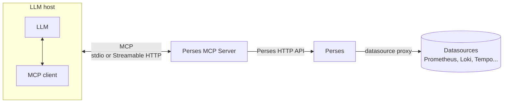

# Overview

The Perses MCP Server is a [Model Context Protocol (MCP)](https://modelcontextprotocol.io/) server for
[Perses](https://perses.dev). It lets AI assistants and agents (OpenCode, Claude, VS Code, Cursor...) interact with a
Perses instance in a standardized way: browse the projects and the dashboards, create or update dashboards, query the
datasources, manage the roles and the variables, migrate Grafana dashboards...

With the Perses MCP Server, you can ask your assistant things like:

- "List the dashboards of the project `my-app` and tell me which ones use the datasource `prometheus-prod`."
- "Create a dashboard showing the CPU and the memory usage of the pods of the namespace `checkout`."
- "Is the error rate of the job `api` higher than yesterday?"
- "Migrate this Grafana dashboard to Perses and save it in the project `my-app`."

## How it works

The MCP server sits between an **LLM host** (the application you are chatting with) and **Perses**. It exposes a set of
[tools](./tools.md) that the LLM can call, and translates each call into requests to the
[Perses HTTP API](https://perses.dev/docs/perses/latest/api/).

1. The LLM host starts the MCP server (or connects to it) and discovers the tools it provides.
2. When the LLM decides to use a tool, the MCP client of the host sends the call to the MCP server.
3. The MCP server calls the Perses API with the credentials it is [configured](./configuration.md#perses_server-config)
   with, and returns the result to the LLM.

The MCP server doesn't store anything: all the data lives in Perses.

### Transports

The MCP server can communicate with the LLM hosts in two ways:

- **stdio** (default): the LLM host starts the MCP server as a sub-process on the user's machine and talks to it through
  the standard input and output. This is the simplest setup, for a single user.
- **Streamable HTTP**: the MCP server runs as a long-lived HTTP service, and several LLM hosts connect to it through its
  URL. This is the setup for a shared or remote instance.

See [Deployment](./deployment.md) to choose the right one.

### Permissions

The MCP server talks to Perses with a single identity: the user (or the technical account) configured in the
[`perses_server`](./configuration.md#perses_server-config) section. Everything the LLM does goes through the
[Perses authorization](https://perses.dev/docs/perses/latest/concepts/authorization/) of this identity, so the MCP
server can never do more than this user is allowed to.

On top of that, you can restrict the tools exposed to the LLM:

- [`read_only: true`](./configuration.md#definition) only registers the tools reading data. The tools creating,
  updating or deleting resources are not available.
- [`resources`](./configuration.md#resources) only registers the tools of the listed resources, for example
  `dashboard,project`.

> [!TIP]
> Give the identity of the MCP server the smallest set of permissions it needs, and enable the read-only mode unless you
> want the LLM to modify your resources.

## Features

### Manage the Perses resources

The MCP server provides tools to list, get, create, update and delete the main Perses resources:

| Resource                                                                                    | Scopes            |
|---------------------------------------------------------------------------------------------|-------------------|
| [Projects](https://perses.dev/docs/perses/latest/concepts/project/)                         | Global            |
| [Dashboards](https://perses.dev/docs/perses/latest/concepts/dashboard/)                     | Project           |
| [Ephemeral dashboards](https://perses.dev/docs/perses/latest/concepts/ephemeral-dashboard/) | Project           |
| [Datasources](https://perses.dev/docs/perses/latest/concepts/datasource/)                   | Project, Global   |
| [Variables](https://perses.dev/docs/perses/latest/concepts/variable/)                       | Project, Global   |
| [Roles and role bindings](https://perses.dev/docs/perses/latest/concepts/authorization/)    | Project, Global   |
| [Plugins](https://perses.dev/docs/perses/latest/concepts/plugin/)                           | Global, read-only |

The complete list of tools is available in [Tools](./tools.md).

### Query the datasources

The LLM can send queries to the datasources configured in Perses, for example to run a PromQL query on a Prometheus
datasource or a LogQL query on a Loki datasource. The requests go through the
[Perses proxy](https://perses.dev/docs/perses/latest/concepts/proxy/), which means:

- the credentials of the datasources stay in Perses: they are never exposed to the LLM,
- only the endpoints allowed by the configuration of the datasource can be reached.

See [Querying datasources](./tools.md#querying-datasources) for more details.

### Migrate Grafana dashboards

The tool `perses_migrate_dashboard` converts a Grafana dashboard into a Perses dashboard, using the
[migration API](https://perses.dev/docs/perses/latest/migration/) of Perses. The result is returned to the LLM, which
can then save it with the tool `perses_create_dashboard`.

## What's next

- [Install the Perses MCP Server](./installation.md)
- [Connect it to your LLM host](./clients.md)
- [Choose how to deploy it](./deployment.md)
- [Configure it](./configuration.md)
